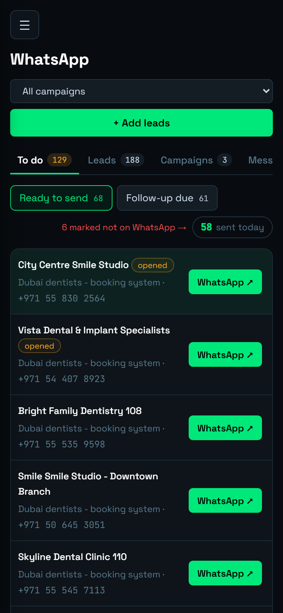
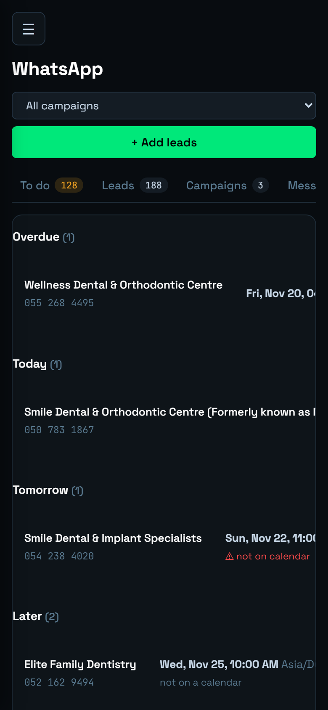
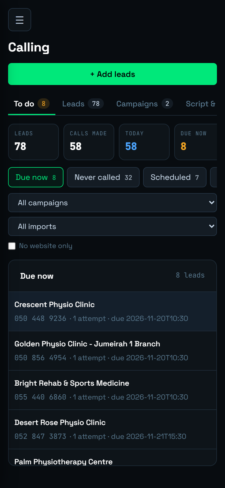

# ShoutReach — full audit, 2026-11-21

**Audited at:** commit `062a98d` on `master` · **Scope:** front end (most of the effort) and back end · **Supersedes:** `Fable Audit.md` and `Full App Audit 2026-09-09.md`, whose open items are carried into §7.

This is an audit, not a build. Nothing in the app was changed. Every finding
has an id (F = front end, B = back end) so later work can point at it.

**Build plans** made from this audit are in [docs/plans/](../plans/README.md).

**How to read it.** §0 is the whole thing in one page. §2 is what to fix
straight away, whatever happens with the redesign. §3 is what's wrong with the
look and feel and why. §4 is the proposed new direction. §8 is the order to
build it in.

---

## Status

| | |
|---|---|
| Fix-now items (§2) | 0 of 19 done |
| Front-end findings (§3) | 0 of 43 done |
| Design direction (§4) | agreed in mockup form on 2026-11-21 ("the mockups look good"); mark saved as `static/img/hexiv-mark.svg` |
| Back-end findings (§5–§6) | 0 of 31 done |

Convention as in [README.md](README.md): a finding is marked `✅ RESOLVED` in
place, with the commit and how it was checked.

---

## 0. The short version

**The app works, and the thinking behind it is good.** The same tabs on every
channel, one table component, a lead that opens beside its list, and wording
that talks like a person ("Did it send?", "Nothing is recorded until you
say") are all worth keeping. The clutter and the generic look come from the
surface, not from the structure.

**Why it looks like every other AI-built dashboard.** It uses the exact
recipe those tools default to: near-black navy, one neon green, the Space
Grotesk typeface, tiny capital-letter labels in a coding font, a glowing dot,
and emoji for icons. None of it comes from Hexiv. The only Hexiv thing on
screen is the words "Powered by Hexiv".

**Why it feels cluttered.** Four measured causes:

1. **Too much sits above the work.** On a phone, the first WhatsApp lead
   starts 343 px down an 844 px screen, and only 4 leads fit. On Calling the
   first lead starts at 505 px — 60% of the screen is headings, tiles and
   filters.
2. **Everything is shouting.** The WhatsApp To do screen on a phone shows six
   bright green buttons at once. When every row has a primary button, there
   is no primary button.
3. **No shared scale.** 18 text sizes, 12 corner sizes and 25 spacing values
   are in use. Nothing lines up because nothing was measured against the same
   ruler.
4. **Long names break the tables.** A campaign name wraps onto four or five
   lines in the WhatsApp list, so each row is 100–123 px tall and the phone
   number column is pushed off the screen.

**Three things that need fixing before any redesign** (all reproduced):

- **B-1 (high): an opt-out isn't permanent.** An address that unsubscribed or
  bounced becomes sendable again if your co-founder imports it afterwards, if
  a deleted lead is restored, or if the lead is edited. This breaks the rule
  that an opt-out binds everyone.
- **B-2 (high): the Activity log is readable by non-admins.** The tab is
  hidden, but the address behind it answers anyone signed in, and the log
  holds both operators' recipient addresses and subject lines.
- **B-3 (high): deleting an account or changing its password doesn't sign it
  out.** An already-open session keeps working — a deleted admin could still
  reset other people's passwords.

The wall between the two of you otherwise held: 468 checks of one account
against the other's leads found no other way through (§5).

**And two things about keeping it running** (§6):

- **B-23 (high): the background sender can die silently.** If the database
  stays busy for more than ten seconds — a big import will do it — the
  thread that sends email and checks for replies stops, and nothing restarts
  it or tells you. Reproduced.
- **B-24 (high): the only backups the repo shows are made at deploy**, on the
  same disk. The newest is over three weeks old.

**The proposal in one line.** Rebuild the look from the logo — black, one
teal, white — with a single type scale, one accent used for one action per
screen, real icons, and a phone layout designed for the thumb. The two live
Hexiv sites already define the palette and the typeface; the app should use
them. Keep every
layout decision you've already made. No rewrite; the existing code can take
it in six phases (§8).

---

## 1. How this was done

- **The app was run, not just read.** A throwaway copy was started on this
  machine against a scratch database of invented leads: 452 businesses, 233
  WhatsApp leads, 78 call leads, 3 email campaigns, 5 booked meetings, long
  names included. Sending was switched off. The live site was never contacted, and
  the real `outreach.db` was never written to (one review pass opened it
  read-only to count rows; its timestamp is unchanged).
- **Every section and tab was opened in a real browser** (Chromium, driven by
  Playwright) at 1440×900 and at phone size (390×844) as an admin. The
  WhatsApp, Calling and leads screens were also checked at 1280, 1024 and
  960 px wide. The non-admin account was walked through on a phone, and a
  brand-new account with nothing in it on a computer. About 120 screenshots.
  Fourteen are kept in [evidence-2026-11-21/](evidence-2026-11-21/); all show
  fake data.
- **Not opened:** the Zoho connect flow (it needs real Zoho), a scrape in
  progress (it needs a worker), and the public unsubscribe page.
- **Things were measured rather than eyeballed:** tap-target sizes, colour
  contrast, where the first row lands, how many requests a screen makes, what
  the keyboard can reach.
- **The back end** was reviewed in three passes: every open item in the two
  older audits re-checked against today's code; a security review of
  everything written since the last one (commit `a5e985d`, 2026-09-09); and a
  performance and structure review. The serious claims were then re-proved by
  hand against scratch databases before going in this document.

**Limits.**

- The test browser is Chromium. Anything that depends on a real iPhone
  (Safari) is marked as expected rather than seen.
- The live server's own setup — nginx, the systemd unit, whether responses
  are compressed, which environment variables are set — isn't in the repo and
  wasn't inspected.
- The booking dialog, the meeting box, the Booked tab and the Zoho settings
  were reviewed **for looks and layout only**. Findings there are marked
  *(calendar)*. Their future depends on a decision outside this audit: the
  two Hexiv websites now book through Cal.com
  ([Cal.com Booking Handoff](../Cal.com%20Booking%20Handoff.md)). On
  2026-11-21 the operator decided to retire ShoutReach's own Zoho booking,
  which was never connected, in favour of it
  ([Plan 2](../plans/2%20Cal.com%20integration.md)). **These go with it and
  need no separate fix:** the backslash crash in B-8, the
  meeting-defaults half of B-7, the Zoho tokens in B-13 and the Zoho wait in
  B-17. F-19, F-23 and F-24 stay, because a Booked list is needed either way,
  but they should be fixed in whatever form that list takes next.

---

## 2. Fix now — independent of the redesign

Small, self-contained, and worth doing first. Effort: **S** under an hour,
**M** about half a day, **L** a day or more.

| # | What | Severity | Effort | Detail |
|---|---|---|---|---|
| 1 | ✅ An opt-out can be undone three ways — the other operator importing the address, Restore, or an edit | High | M | B-1 |
| 2 | Activity log readable by non-admins | High | S | B-2 |
| 3 | Deleting an account or changing its password doesn't sign it out | High | M | B-3 |
| 4 | Activating an email campaign sends real email with no confirmation and no count | High | M | B-9 |
| 5 | One campaign's bad value stops email sending for everyone | Medium | S | B-6 |
| 6 | The background sender can die silently and never restart | High | S–M | B-23 |
| 7 | No backup that the repo shows except at deploy, on the same disk — set up a nightly one that leaves the VM | High | S, no code | B-24 |
| 8 | Calling → "Reopen" answers "not found" | Medium | S | B-22 |
| 9 | Email → To do shows two "Done" buttons on every row | Medium | S | F-20 |
| 10 | Calling shows raw timestamps (`2026-11-20T10:30`) | Medium | S | F-21 |
| 11 | Phone: the menu button covers the logo when the menu is open | Low | S | F-22 |
| 12 | WhatsApp: the Booked count reads 0 until you open the tab — *moved to Plan 2: the Booked tab becomes a Meetings page* | Medium | S | F-23 |
| 13 | WhatsApp → Booked is unreadable on a phone: the meeting time is cut off — *moved to Plan 2* | High | M | F-24 |
| 14 | Dashboard "Sent today" is the whole install's figure, shown as yours | Low | S | B-10 |
| 15 | "Check for email replies & send" is shown to non-admins and answers "Forbidden" | Low | S | F-25 |
| 16 | Typing in any box on an iPhone zooms the page (expected, not seen) | Medium | S | F-30 |
| 17 | WhatsApp list rows are 100–123 px tall because the campaign name wraps | Medium | S | F-9 |
| 18 | Get leads keeps asking the server for scraper status every 3 seconds on every screen, for the rest of the session | Medium | S | B-14 |
| 19 | Opening WhatsApp makes 11 requests, 5 of them repeats | Low | S | B-15 |

Next after these, each a half-day job on its own: B-4 and B-5 (the lead audit
fetching internal addresses, and stalling on a hostile page), B-11 (failed
sends retried forever) and B-12 (the bounce check's memory use).

---

## 3. Front end

### 3.1 Identity — why it reads as generic

**F-1 · The palette, type and ornaments are the AI-dashboard default. (High)**
What's on screen, from [main.css:1–21](../../static/css/main.css#L1-L21) and
[index.html:7–9](../../templates/index.html#L7-L9):

| Ingredient | Here | Why it reads as generic |
|---|---|---|
| Background | blue-black `#080c10` | The stock "dark mode" navy |
| Accent | neon green `#00e87a` on everything | The stock "hacker" accent |
| Typeface | Space Grotesk | The single most common face on AI-generated pages |
| Labels | 10–11 px capitals in JetBrains Mono, letter-spaced | "Terminal" styling on things that aren't code |
| Ornament | a pulsing glowing dot ([main.css:106–111](../../static/css/main.css#L106-L111)) | Decoration with no meaning |
| Icons | emoji and symbols: 📣 ◉ ⊕ ✉ ☎ 💬 ⊗ ⚙ ⟳ ⎋ | Drawn differently on every device; none match |

**F-2 · Nothing on screen comes from Hexiv. (High)** The logo — a teal
hexagon (`#00A3AD`), a heavy white wordmark, pure black — appears nowhere.
The browser-tab icon is a megaphone emoji. The sidebar says "Powered by
Hexiv" in green capitals, which is the opposite of the logo's colours. The
old landing and portfolio pages in the repo root use a third look again
(Inter, a different green, `#00e5a0`).

The two **live** sites, hexiv.co.uk and hexiv.co, do have a consistent
identity, and ShoutReach shares none of it: both use a teal taken from the
logo, Inter for body text, and each defines its own dark theme (checked in
their source, 2026-11-21). §4 starts from those.

**F-3 · Three channel colours fight the meaning of colour. (Medium)** Email
is green, Calling is blue, WhatsApp is purple
([main.css:747–749](../../static/css/main.css#L747-L749)). So green means
"Email", and "primary button", and "success", and "selected", all at once;
and WhatsApp — a green brand — is purple. A colour that means four things
means nothing.

**F-4 · The sign-in page has its own look. (Low)** It carries its own
109-line stylesheet and a blue button, while the app's main button is green
([login.html](../../templates/login.html)). The first screen anyone sees
doesn't match the second.

### 3.2 The system underneath

**F-5 · There is no scale. (High)** Counted across the stylesheet, the
templates and the scripts:

| | In use | A designed system would have |
|---|---|---|
| Text sizes | 18 (9.5, 10, 10.5, 11, 11.5, 12, 12.5, 13, 13.5, 14, 15, 16, 17, 18, 20, 22, 28, 36 px) | 5 or 6 |
| Corner sizes | 12 (3, 4, 6, 7, 8, 9, 10, 12, 14, 20 px, 50%, pill) | 3 |
| Spacing values | 25 between 1 and 64 px | 6 or 7 |
| Layering values | 13 (1 to 9999) | 5 named layers |

One screen shows the result: Calling → To do on a phone has **ten** text
sizes visible at once; WhatsApp → To do has eight. Sizes half a pixel apart
(12, 12.5, 13, 13.5) can't be told apart by eye but still stop things lining
up.

**F-6 · Four designs for one job. (Medium)** A small coloured label is a
`badge`, a `pill`, a `chip` or a tab `count`, each with its own size, border
and colours ([main.css:207–220](../../static/css/main.css#L207-L220),
[551–582](../../static/css/main.css#L551-L582)). Chips are also used as
filters, so the same shape is sometimes a status and sometimes a button.
There are likewise three label styles for form fields: capitals in the coding
font ("MESSAGE"), ordinary case in the coding font ("Notes", "Outcome"), and
plain text.

**F-7 · The good news: colours already go through named variables.** Almost
every solid colour is `var(--green)`, `var(--muted)` and so on — about 450
references. So a change of palette reaches most of the app from one place.
**Two catches:**

- `--green` is used for the brand *and* for "success" (49 references). It has
  to be split into "accent" and "success" before teal goes in, or every
  "sent" and "replied" turns teal too.
- The pale tints behind pills, notices and selected rows are written out by
  hand as the old colours at low strength (`rgba(0,232,122,.12)` and the
  like): 46 in the stylesheet, 21 more in the scripts and templates. Those
  won't follow a variable and have to be replaced with tint variables.

**F-8 · Leftovers.** Styles nothing uses: the scheduler status pill and its
pulsing animation, and the `.seg` three-way switch
([main.css:92–111](../../static/css/main.css#L92-L111),
[703–710](../../static/css/main.css#L703-L710)). A tap-to-explain helper,
`infoDot`, is defined and styled but never called, while 52 explanations live
in hover-only tooltips that a phone can't show
([utils.js:52](../../static/js/utils.js#L52)).

### 3.3 Clutter, screen by screen

WhatsApp first and deepest, as agreed.

#### WhatsApp → To do

**F-9 · The list wastes its height. (High · fix-now 17)** On a computer the
list has four columns — Business, Campaign, Version, Number
([whatsapp.js:338](../../static/js/whatsapp.js#L338)). The campaign name
wraps onto four lines, so every row is about 100 px tall; at 1440 px wide
five and a half leads fit, and the Number column shows only "+971". At
1280×720 four leads fit and Number is gone. Version reads "—" on every row
unless a campaign runs two versions. The campaign is the same on almost every
row, and is already in the heading when one is picked.
See [desktop-whatsapp-todo.png](evidence-2026-11-21/desktop-whatsapp-todo.png).

**F-10 · On a phone, 40% of the screen is used before the first lead.
(High)** In order: the menu button on a row of its own, the title, the
campaign picker, a full-width "+ Add leads" button, the tabs, two filter
chips, and a line with "6 marked not on WhatsApp" and "58 sent today". The
first lead starts 343 px down. Four fit.

**F-11 · Six primary buttons on one screen. (High)** "+ Add leads" is the
biggest, brightest thing on the page — and adding leads is the one thing you
are *not* there to do. Under it, every row has its own bright green
"WhatsApp ↗" button. The eye has nowhere to land.

**F-12 · The action sits in the middle of the screen, not under the thumb.
(High)** In the open lead, "Open in WhatsApp" is about halfway down, with the
bottom half of the screen empty. After opening, "Did it send?" shows three
buttons that wrap onto two rows, and **Sent** — the button pressed more than
any other in the app — is the smallest of the three.
See [phone-whatsapp-did-it-send.png](evidence-2026-11-21/phone-whatsapp-did-it-send.png).

**F-13 · In a half-width window, the lead you pick is off the screen. (High)**
Between 769 and 1100 px wide the list and the lead stack on top of each other
([main.css:838–841](../../static/css/main.css#L838-L841)). Measured in a
960 × 1040 window — a browser snapped to half of a normal monitor: the list
fills the screen from 239 to 1001 px, the lead begins at 1019 px, and "Open
in WhatsApp" sits at 1325 px, well below the bottom edge. Clicking a lead
doesn't scroll to it, so it looks as if nothing happened. The phone fix (the
lead opens full screen) only applies at 768 px and below, so this middle
range has neither layout. It matters if you ever keep ShoutReach beside
WhatsApp instead of in a separate tab.

**F-14 · No keyboard path through the queue. (Medium)** Open, Sent, next:
each is a mouse trip. List rows can't be reached with the keyboard at all
(0 of them can take focus).

#### WhatsApp → Leads

**F-15 · The table doesn't fit its own card. (High)** At 1440 px the toolbar
wraps onto two rows and the last columns are cut off mid-word. With a lead
open beside it, only two columns remain visible — Business and Campaign — and
the campaign name wraps onto **five** lines, so each row is 123 px tall and
four leads fit. Deal and Version read "—" on nearly every row.
See [desktop-whatsapp-leads-panel.png](evidence-2026-11-21/desktop-whatsapp-leads-panel.png).

**F-16 · The lead panel repeats itself and buries the important action.
(Medium)** The status pill appears twice ("Replied … / Replied — No more
follow-ups"). The panel has both "← Back to list" and a ✕ that do the same
thing, plus an unlabelled pencil. "Take off" is a red-outlined button beside
two neutral ones, so the destructive choice is the most eye-catching.
Meanwhile "+ Set a stage" — how a lead becomes a booked meeting — is a small
blue text link.

#### WhatsApp → Messages, Campaigns, Add leads

**F-17 · Tabs run off the side of a phone with no hint. (Medium)** "Messages"
is cut to "Mess" and "Booked" is entirely off-screen; the scroll bar is
hidden ([main.css:914–918](../../static/css/main.css#L914-L918)), so nothing
says there is more. 139 px of tabs are out of sight.

**F-18 · Boxes inside boxes. (Medium)** On a phone, Messages is a card inside
the page with its own padding, holding a notice box, holding fields — three
borders deep, each taking width from a 390 px screen. "+ Add leads" stays
pinned at the top of the Messages tab, where it has no purpose. In the Add
leads window, phone numbers break onto three lines ("055 / 863 / 2046").

#### WhatsApp → Booked *(calendar — looks only)*

**F-24 · The time of the meeting is cut off on a phone. (High · fix-now 13)**
Each row is an ordinary four-column table row with no phone layout
([whatsapp.js:1005](../../static/js/whatsapp.js#L1005) onward), so the
date runs off the right edge ("Fri, Nov 20, 0…") and a long business name
pushes the time out of sight completely. Signed in as the non-admin account,
the campaign name beside it is squeezed into a column two letters wide. The
one fact this tab exists to show is the one you can't read.

**F-19 · Columns don't line up, and the Join button can vanish. (Medium)**
Overdue, Today, Tomorrow and Later are four separate tables, so the "when"
column starts in a different place in each. Group headings sit hard against
the card's edge with no padding. With a lead open beside the list, a long
name pushes Join and .ics off the right edge.
See [desktop-whatsapp-booked.png](evidence-2026-11-21/desktop-whatsapp-booked.png).

**F-23 · The Booked count says 0 until you open the tab. (Medium · fix-now
12)** It is only set when that tab loads
([whatsapp.js:1004](../../static/js/whatsapp.js#L1004)). Five meetings were
booked and the tab read 0 from every other tab. This is the same family of
fault as the Leads count that misled your co-founder in September (Handover
§5b).

#### Calling → To do

**F-26 · Six zones stacked before the lead. (High)** Six stat tiles, five
filter chips, two dropdowns, a checkbox, the queue (capped at 300 px, five
rows), then the lead card, with the script to the side
([calling.html:23–66](../../templates/sections/calling.html#L23-L66)). On a
900 px-tall screen the lead you're calling — notes, outcome, save — is below
the fold. On a phone the first lead starts at 505 px. The tiles (Leads, Calls
made, Today, Booked, Not interested) are reports, not work; they belong on
the Dashboard or the Campaigns tab.
See [desktop-calling-todo.png](evidence-2026-11-21/desktop-calling-todo.png).

**F-27 · The most-used buttons are the smallest. (High)** The nine outcome
buttons are 30 px tall with grey text on a dark fill
([calling.js:600–605](../../static/js/calling.js#L600-L605)), and wrap onto
five rows on a phone. Each row in the queue also has its own "Open" button,
though the whole row is already clickable.
See [phone-calling-lead.png](evidence-2026-11-21/phone-calling-lead.png).

**F-21 · Raw timestamps. (Medium · fix-now 10)** Callbacks show as
`2026-11-20T10:30`, call history as `2026-11-21 21:27`
([calling.js:207](../../static/js/calling.js#L207),
[511](../../static/js/calling.js#L511)). See F-33 for the wider date problem.

#### Dashboard

**F-28 · Eighteen numbers, none of them an instruction. (Medium)** Six tiles,
three cards of four figures each, then a campaigns table. On a phone the six
tiles stack one per row, 100 px each, with "WHATSAPP" printed three times,
and the page is two and a half screens long. A brand-new account sees
eighteen zeros and a line of grey text — no first step
([desktop-dashboard-new-user.png](evidence-2026-11-21/desktop-dashboard-new-user.png)).
The Refresh button is the most prominent control on the phone version.
See [desktop-dashboard.png](evidence-2026-11-21/desktop-dashboard.png) and
[phone-dashboard.png](evidence-2026-11-21/phone-dashboard.png).

**F-29 · Zeros look like eights. (Medium)** Big numbers are set in JetBrains
Mono, whose zero has a slash through it. At a glance "0" reads as "8" or
"θ" — on the one screen whose job is to be read at a glance.

#### Email

**F-20 · Two "Done" buttons on every To do row. (Medium · fix-now 9)** The
row has a button for computers and a second one meant for phones
([email_leads.js:72](../../static/js/email_leads.js#L72) and
[76](../../static/js/email_leads.js#L76)), but only the phone *card* is
hidden on a computer, not the phone *button*
([main.css:857](../../static/css/main.css#L857)). The heading row is also one
column short as a result.
See [desktop-email-todo.png](evidence-2026-11-21/desktop-email-todo.png).

**F-31 · Email breaks the "tables, not tiles" rule. (Medium)** Email →
Campaigns is a stack of large cards; WhatsApp → Campaigns is a table. Inside
a campaign, the page has a different header layout from every other screen,
buttons in Title Case ("Add Step", "Remove Selected", "Export Excel"), a red
"Remove Selected" that's lit even with nothing selected, and a red-outlined ✕
on every row — seven red boxes down the right edge, so deleting is the
loudest thing on the page. On a phone a campaign tile is about 310 px tall:
the name breaks one word per line ("Dubai / dentists / - / website /
refresh") because the status, Manage, Activate and delete don't wrap beside
it, and Activate sits right next to delete.

**F-43 · Leads tables need sideways scrolling on a laptop. (Medium)** At
1280 px wide, Email → Leads is 407 px wider than its card and Calling → Leads
381 px wider. At 1440 px the phone column on Email → Leads is still cut off,
and "Not in a campaign" wraps onto two lines on every row.

#### Get leads, Settings, Contacts

**F-32 · Developer instructions as the page's headline. (Medium)** Get leads
opens with an amber "No worker connected" box holding eleven lines of
PowerShell. The same block appears again in Settings
([scraper.html:33–45](../../templates/sections/scraper.html#L33-L45),
[settings.html:46–57](../../templates/sections/settings.html#L46-L57)). It's
needed once per laptop; it's shown every visit — including on a phone, where
it fills most of the first screen and can never be used.

**F-34 · Team setup is one page, eight cards, 2,700 px long. (Low)** Four
save buttons in three sizes ("Save Rules", "Save", "Save key", "Save Zoho
setup"). One tick box has drifted away from its own label ("Include
unsubscribe header + footer in emails"). The warm-up schedule is a reference
table, not a setting.

**F-35 · Tick boxes are the browser's own. (Low)** Bright white squares on a
dark page, ticking purple. Only radio buttons were given the app's colour
([main.css:718](../../static/css/main.css#L718)).

### 3.4 Visible defects not already listed

**F-22 · The phone menu button covers the logo. (Low · fix-now 11)** The
button is fixed above the drawer
([main.css:468–474](../../static/css/main.css#L468-L474)), so an open menu
reads "☰ utReach".
See [phone-menu-open.png](evidence-2026-11-21/phone-menu-open.png).

**F-25 · A button that only works for admins is shown to everyone. (Low ·
fix-now 15)** "Check for email replies & send" sits in everyone's sidebar
([sidebar.html:27–29](../../templates/sections/sidebar.html#L27-L29)); for a
non-admin it answers "Forbidden". Reproduced.

**F-36 · Page headings jump between sections. (Low)** Settings has no
subtitle, so its tabs sit 23 px higher than everywhere else. The filter note
under WhatsApp → Leads ("Filtered — showing only…") touches the card edge.

### 3.5 Consistency

**F-33 · Five ways of writing a date. (Medium)**

| Where | Looks like |
|---|---|
| Email → To do | `Nov 21, 05:57 PM` |
| WhatsApp → Booked | `Fri, Nov 20, 04:00 PM` |
| "Did it send?" | `at 06:00 PM` |
| Calling queue | `2026-11-20T10:30` |
| Call history, campaign leads | `2026-11-21 21:27` (and in UTC, not your time) |

Three date helpers exist (`whenLocal`, `shortDate`, `localDateTime`) beside
about twenty places that just chop the raw string
(`.substring(0, 16)` / `.substring(0, 10)`).

**F-37 · Words and buttons. (Low)** Button labels mix Title Case and sentence
case ("+ Add Account" / "+ Add leads", "Save Rules" / "Save key"). Symbols
stand in for icons inside labels (⬆ ⬇ ⏹ ▶ ✓ ✕ ⚙ ⊞ ↻). Seventeen confirmations
still use the browser's own grey pop-up
(for example [campaigns.js:89](../../static/js/campaigns.js#L89),
[settings.js:424](../../static/js/settings.js#L424)), while newer screens use
the app's own dialog — so "are you sure?" looks different depending on where
you are.

### 3.6 Reach, touch and legibility (measured)

**F-38 · Grey text is too faint. (Medium)** The secondary grey `#5a7a90` —
used for most small print — measures 4.3 : 1 against the page, 4.1 : 1 on
cards and 3.8 : 1 on fields. The accepted floor for small text is 4.5 : 1,
and this grey is mostly used at 11–12.5 px. Field borders measure 1.2–1.5 : 1,
so boxes are barely visible against the page; the floor for a control's
outline is 3 : 1.

**F-39 · Most tap targets are under size. (High)** The comfortable minimum
for a finger is 44 px. Measured on a 390 px screen:

| Control | Size |
|---|---|
| "WhatsApp ↗" on each row | 101 × 34 |
| ⋯ menu in an open lead | 32 × 25 |
| Call outcome buttons | 30 tall |
| Filter chips | 35 tall |
| Tabs | 38 tall |
| Dropdowns | 33 tall |
| Menu button | 40 × 40 |
| Text links ("Reset to template", "Open the chat again") | 31 tall |
| Tick boxes in lists | 20 × 20 |

**F-30 · Expected: every text box zooms the page on an iPhone. (Medium ·
fix-now 16)** Safari zooms in when a field's text is smaller than 16 px.
Every field here is 13–14 px — the message box, search, notes. Not seen
directly (the test browser is Chromium), but the cause is certain and the fix
is one line.

**F-40 · Keyboard and screen-reader basics. (Low for a two-person tool; cheap
to fix alongside the rest)** Of 117 form fields, 10 are tied to their label.
The whole page has one accessibility attribute. Windows don't close on
Escape, don't take the cursor when they open, and aren't announced as
windows. Dropdowns and the search box have their focus outline removed and
nothing put in its place
([main.css:446–449](../../static/css/main.css#L446-L449)). Fourteen buttons
are a symbol with no name.

### 3.7 States

**F-41 · Nothing says "loading", and a failure looks like an empty list.
(Medium)** Tested by holding back and breaking requests on purpose:

| What happened | What the screen showed |
|---|---|
| Contacts list took 4 seconds | A blank card. No spinner, no "loading" |
| The connection dropped while WhatsApp → To do loaded | A blank list and "Pick a lead from the list." No message at all |
| The server answered with an error on WhatsApp → Leads | A blank table, a blank count, and the server's raw error word in a toast for three seconds |

On a phone on mobile data, the first of these is the normal case. The second
is the dangerous one: a dropped connection is indistinguishable from "you
have no leads". Empty lists do have messages (28 of them), and several are
good, but none carries a button for the next step.

### 3.8 What the code allows

**F-42 · A restyle is practical; a relayout takes more care. (context for
§8)**

- **What helps.** Colours go through variables (F-7). One table component
  (`createLeadTable`) draws every leads table, one function draws the lead
  panel, one draws every choice dialog. Change those and most screens follow.
- **What hinders.** About 600 `style="…"` attributes are written straight
  into the HTML and scripts — 312 of them inside JavaScript strings — plus
  roughly 340 `onclick="…"`. A stylesheet can't reach an inline style without
  force, which is why the phone rules use `!important` 13 times. Layout
  decisions (grid columns, widths, margins) are scattered through
  [whatsapp.js](../../static/js/whatsapp.js) (71),
  [lead_panel.js](../../static/js/lead_panel.js) (68),
  [campaigns.js](../../static/js/campaigns.js) (63),
  [calling.js](../../static/js/calling.js) (57) and
  [settings.html](../../templates/sections/settings.html) (64).
- **Phone rules are a patch on top.** They live in four separate blocks at
  the end of [main.css](../../static/css/main.css), written to undo the
  computer layout rather than designed first.
- **There is no browser test.** Twenty-five test scripts cover the server.
  Nothing checks that a screen still renders, which is how F-20 and F-23
  reached production.

**Recommendation: don't rewrite.** Moving to React or similar would cost
weeks and put the tested server behaviour at risk for no visible gain. Keep
plain HTML, CSS and JavaScript; introduce the scale as variables; move inline
styles into named classes one screen at a time, as each is redesigned.

---

## 4. Design direction (proposed)

A direction to react to, in words. Nothing here is built.

### 4.1 What "premium" means here

Not decoration. A tool feels expensive when it is **quiet, exact and fast**:
one thing emphasised per screen, everything on the same grid, nothing that
moves or glows without a reason, and the next action always under your hand.
The logo already says this — black, one colour, heavy plain letters, a
geometric mark.

### 4.2 From the logo — and from the live sites

Hexiv already has a dark palette: hexiv.co defines one, built round "teal
pulled from the Hexiv logo". Starting there makes the app and the site one
family, and it is a better starting point than inventing a new one.

| | ShoutReach now | Proposed — hexiv.co's dark theme |
|---|---|---|
| Background | blue-black `#080c10` | `#0b1519` — near-black with a slight teal cast |
| Cards / sidebar | `#0e1419` | `#101d22` |
| Fields, hover, menus | `#141c24` | `#15262c` |
| Main text | `#c8d8e8` | `#e7eef0` |
| Secondary text | `#5a7a90` — 4.1 : 1 | `#a3b8be` — 8.3 : 1 |
| Faint text | — | `#6d8890` — 4.6 : 1 |
| Accent | neon green `#00e87a` | **teal `#3cc1d0`** — the logo's teal lightened for dark backgrounds, 8.0 : 1. The hexagon mark itself stays the logo's own `#00A3AD` |
| Text on the accent | black | `#06272c` — 7.3 : 1 |
| Sent / replied / booked | the same green as the accent | a calmer green `#3FB97A`, used only for "done" |
| Needs attention | `#f5a623` | `#E0A23B` |
| Destructive | `#ff4c4c` | `#F0645A` |
| Dividers | `#1e2c38` | `#1e3238`, the site's own |
| Field outlines | 1.2–1.5 : 1 | lighter than the divider, to reach 3 : 1 — the site's divider colour is too faint for the edge of a box you type in |

Contrast figures are computed against the card colour. The last three status
colours are mine; the sites don't define any, because they have no states to
show.

The darkness is close to what ShoutReach has now. What changes is the hue —
one teal instead of a neon green and four other colours — and how sparingly
it is used.

**Rules for colour.**

- **Teal means "this is the thing to do" and "this is selected".** One teal
  button per screen. Never a row of them.
- **Green, amber and red mean state only** — done, waiting, problem. They are
  never button colours, except red on the final "yes, delete" in a dialog.
- **Channels lose their colours.** Email, Calling and WhatsApp are told apart
  by icon and name. That removes blue and purple from the app entirely.
- **The greys carry the site's slight teal cast and nothing else.** With blue
  and purple gone, the teal reads as *the* colour instead of one of five.

### 4.3 Type

- **Inter for the interface.** Both live sites already use it for body text,
  so this is Hexiv's typeface in practice. It stays clear at 12–13 px and its
  zero has no slash (F-29). Hosted with the app, not fetched from Google.
  An earlier draft of this audit leaned towards IBM Plex Sans for
  distinctiveness; having read the sites, matching them matters more, and
  hexiv.co already uses IBM Plex Sans **Arabic** as its Arabic face, so Plex
  is in the family where it's needed.
- **Headings are the one thing the two sites don't agree on.** hexiv.co.uk
  sets them in Space Grotesk — the face this audit calls the AI-dashboard
  default (F-1) — and hexiv.co in Sora. An app doesn't need a separate
  heading face: use Inter throughout, heavier for titles. If you want one
  echo of the site, set the "ShoutReach" name beside the hexagon in Sora.
  Whether the UK site should move off Space Grotesk is a question for that
  site, not this audit.
- **The coding font only for codes:** phone numbers, keys, `{{placeholders}}`.
  Not for labels, headings or big numbers.
- **Six sizes, three weights.**

  | Use | Computer | Phone |
  |---|---|---|
  | Page title | 20 | 20 |
  | Section / lead name | 16 | 17 |
  | Body, table cells, buttons | 14 | 15 |
  | Fields | 14 | **16** (stops the iPhone zoom) |
  | Secondary | 13 | 13 |
  | Small print, counts | 12 | 12 |

- **Labels become plain words** in secondary grey, sentence case. No capitals,
  no letter-spacing.
- **Numbers line up in columns** (tabular figures), in the interface font.

### 4.4 Space, shape, depth, motion

- **Spacing on a 4 px grid:** 4, 8, 12, 16, 24, 32. Nothing in between.
- **Three corner sizes:** 6 px for controls, 10 px for cards and windows,
  fully round for tags.
- **Fewer boxes.** Depth comes from the three background steps, not from a
  border round everything. A card inside a card loses its border. On a phone,
  lists run edge to edge with no card at all.
- **One row height:** 40 px on a computer, 52 px on a phone. One line per
  lead; long names end in "…", with the full name on hover or in the lead.
- **Motion:** 120–160 ms on hover and press; the phone's lead sheet slides up
  in 200 ms. No pulsing, no glow. Switched off for anyone whose device asks
  for reduced motion.
- **Focus:** a 2 px teal outline on anything the keyboard lands on.

### 4.5 Parts

| Part | Now | Proposed |
|---|---|---|
| Logo | text + "Powered by Hexiv" | the hexagon mark beside "ShoutReach"; hexagon as the browser-tab icon |
| Icons | emoji and symbols | one outline icon set, drawn at 16 and 20 px, shipped with the app |
| Buttons | green / outline / red outline / amber outline, two sizes | **primary** (teal, one per screen), **secondary** (quiet fill), **text**; destructive lives in a menu or a confirm dialog |
| Status labels | badge, pill, chip, count | one **tag** (a dot and a word) and one **count** |
| Filters ("Ready to send / Follow-up due") | chips that look like tags | a **segmented switch** — one control, two halves |
| Fields | three label styles | one |
| Confirmations | 17 browser pop-ups + the app's dialog | the app's dialog everywhere |
| Tick boxes | browser default | drawn to match, teal when ticked |
| Dates | five formats | one helper: "Today 3:30 pm", "Tomorrow 11:00 am", "Wed 25 Nov, 10:00 am", always your own time |
| Empty lists | a grey sentence | a sentence plus the button for the next step |
| Loading | nothing | grey placeholder rows while a list loads; a plain message and "Try again" when it fails |

### 4.6 The frame

**Computer.** Keep the left sidebar and its grouping. Hexagon and name at the
top; icons from the one set; counts as quiet numbers, teal only when
something is due. "Check for email replies & send" moves to the Email page
and is shown to admins only (F-25). The sidebar can fold to icons, giving
tables another 164 px at laptop widths.

**Phone.** Replace the menu button with:

- a **48 px top bar**: the hexagon, the page title, and one action;
- a **bottom bar** with five places — Today, WhatsApp, Calling, Email, More
  (Contacts, Get leads, Settings, Help).

A channel is then one thumb tap from anywhere (two now: menu, then item), and
the title no longer needs a row of its own.

**Every page starts the same way:** title and its one action on one line;
tabs directly under; then the work. No subtitle sentence under the title —
that guidance moves into the empty state, where it's needed.

### 4.7 WhatsApp, redesigned in words

**To do — phone.** Targets: first lead within 200 px of the top (343 now); at
least seven leads on screen (four now); one teal button on screen (six now).

- The **campaign name is the title**; tap it to switch campaign. "+ Add
  leads" becomes a plus icon in the top bar.
- Under the tabs, **one switch**: Ready 68 | Follow-up 61. "58 sent today"
  sits beside it as plain text. "6 not on WhatsApp" appears only when there
  are some, as a single quiet line.
- **Rows:** name, then number and city on one grey line. No campaign (it's
  the title). Tap anywhere to open. A small outline WhatsApp icon at the
  right keeps the one-tap open, without colour.
- **The open lead:** name and "3 of 68" in the top bar. Message box first.
  Notes, Audit and History fold below as now.
- **A bar fixed to the bottom of the screen**, under the thumb:
  - before opening: **Open in WhatsApp** (teal, full width) and Skip;
  - after opening: **Sent** (teal, about two-thirds of the width, 52 px
    tall), then Not on WhatsApp and Didn't send as two equal quiet buttons
    beneath or beside it.
- After **Sent**, the next lead slides in, as it does now.

**To do — computer.** List on the left, lead on the right, as now.

- The list is one line per lead — name, number, and either "new" or "2
  follow-ups · 5 days ago". At 1440 px that is about sixteen leads instead of
  five.
- **Two columns hold down to about 820 px**, so half a screen beside WhatsApp
  Web still shows list and lead together (F-13). The list narrows to names.
- **Keys:** ↓ ↑ to move, Enter to open in WhatsApp, S for Sent, N for Not on
  WhatsApp, D for Didn't send. A session becomes: Enter, send in WhatsApp,
  S — repeat.

**Leads.** One toolbar line: search, stage, source, and a "⋯" for rows per
page and full screen. Columns that are empty for everyone (Deal, Version)
hide themselves. With a lead open, the table keeps name and stage only.
In the panel, the stage becomes a proper control at the top — the lead's
position in the pipeline is the first thing you want — and "Take off" moves
into the ⋯ menu.

**Booked** *(calendar — depends on the Cal.com decision, §1)*. One table with
fixed columns — When, Business, Campaign, Calendar, actions — and the four
groups as sub-headings within it. On a phone each meeting is two lines: the
time first and bold, then the business and its calendar state.

**Messages.** No outer card on a phone. Campaign settings (name, country,
gaps) fold away under "Campaign settings", so the page opens on the messages
themselves.

### 4.8 The other screens, briefly

- **Calling → To do.** Same shape as WhatsApp: list left, lead right. The six
  tiles go to the Campaigns tab. The script becomes a tab inside the lead
  panel on small screens and a third column on wide ones. Outcomes are a
  two-column grid of 48 px buttons, commonest first, with the rest under
  "More". Bottom bar on a phone: **Save & next**.
- **Dashboard → "Today".** Three rows instead of eighteen numbers: WhatsApp —
  68 to send, 61 follow-ups → *Start*; Calling — 8 callbacks → *Start*;
  Email — 7 replies → *Answer*. Then the next three meetings. Then campaigns
  as one compact table. A new account sees three steps instead of zeros: get
  leads, write a message, send the first one.
- **Email.** Campaigns as a table. Inside a campaign, the standard page
  header; steps as a compact numbered list; per-row delete moves into the row
  menu. Activate asks first, and says how many people it will email (B-9).
- **Get leads.** Worker status as one line — "Worker not connected · How to
  connect" — opening the instructions on request.
- **Settings.** Sections down the left instead of one long page; one save
  button style.
- **Sign in.** The logo, two fields, a teal button. Same stylesheet as the
  app.

---

## 5. Back end — security and the wall between operators

"Seen" means reproduced for this audit on a scratch database or the test
copy. "Read" means confirmed in the current code without running it.

**B-1 · An opt-out isn't permanent: three ordinary actions make an
unsubscribed or bounced address sendable again. (High · seen)**

> ✅ **RESOLVED** — Plan 1, package 1 (commit listed in
> [the build log](../plans/1%20Fix%20now%20-%20build%20log.md)). A new
> `suppressed_addresses` table (address and reason, no owner) is written by
> every unsubscribe, hard bounce and soft-bounce threshold, even with no row
> to mark. `_apply_suppression` makes a copy created later (browser, worker,
> WhatsApp, typed-in, meeting-invite) or restored from Recently deleted end up
> exactly as an existing copy would; the edit route refuses to move a
> suppressed address to any other status; `get_due_enrollments` refuses any
> address in the table. `_migrate_suppressed_addresses` copied existing
> opt-outs. Checked: `tests/test_suppression.py` (new),
> `tests/test_ownership.py` §6, and `tools/audit/checks/suppression_db.py`,
> `suppression_routes.py` and `security_findings.py` S-1a/S-1c, all of which
> now end with the address suppressed and off the due list. Bulk delete of
> addresses is still a hard delete (Fable 3.8), but it no longer forgets a
> bounce.

The rule (Handover §3, CLAUDE.md) is that an unsubscribe or a bounce binds
every operator, for good. In the code, an opt-out is only a status on
whichever copies of the address exist *at that moment*
([db.py:3208](../../db.py#L3208), [3265](../../db.py#L3265)). There is no
separate list of addresses that must never be mailed, so anything that
creates, recreates or edits a row can lose it. All three of these were
reproduced through the app's own routes, each ending with the address back on
`get_due_enrollments` — the send loop's own list of what to send next:

| Path | What happens |
|---|---|
| **The other operator imports it later** | A's contact unsubscribes. B then imports the same address: B's copy is created `active`. The import even reports "A already has this business on Email" and says nothing about the opt-out. B enrols it; it is due to send |
| **Restore from Recently deleted** | A lead mid-sequence is deleted. The recipient clicks Unsubscribe on an email they already have — the link answers "unsubscribed", but there is no row left to mark, so nothing is recorded. Restore within 30 days brings the address back `active` with its place in the sequence |
| **Editing the lead** | `PUT /api/contacts/<id>` accepts `status`, so an unsubscribed address can be set back to `active` in one request ([app.py:1924](../../app.py#L1924)) |

Nothing after the due list checks again: the scheduler goes straight from it
to `send_email` ([scheduler.py:118–188](../../scheduler.py#L118-L188)), and
the query looks only at that one row and its business
([db.py:3757–3760](../../db.py#L3757-L3760)). So with a sending account
configured, the address would be emailed. The same holds for a hard bounce.

Two more ways in, read rather than run: **bulk delete of email addresses is a
hard delete** with no Recently deleted ([db.py:3115](../../db.py#L3115)), so
deleting a bounced address erases the only record that it bounced; and the
worker import and the WhatsApp import create addresses the same way
([db.py:2379](../../db.py#L2379), [6987](../../db.py#L6987)).

The rule is already applied correctly in one place: an address typed for a
meeting invite is checked with `address_suppression`
([db.py:4790](../../db.py#L4790)) and arrives suppressed.

**Fix:** a small table of suppressed addresses, written by every unsubscribe
and bounce *even when no lead row matches*, and checked in three places —
when a lead row is created, when one is restored, and in the due-list query
itself, so the send loop refuses regardless of how the row got there. Stop
accepting `status` on the edit route. Add all three paths to
`tests/test_ownership.py`, which today covers only the case where both copies
already exist. Effort: M.

**B-2 · The Activity log can be read by any signed-in user. (High · seen)**

`GET /api/logs` has no admin check — only clearing the log does
([app.py:2016–2018](../../app.py#L2016-L2018)). The tab is hidden for
non-admins, but the address answers: signed in as the non-admin test account,
it returned the log. Log lines have no owner and include, for everyone's
sends, the recipient's address and the subject line
(`✉ Sent step 2 → name@clinic.ae | subject`,
[sender.py:409](../../sender.py#L409)), bounces, unsubscribes, and the names
of businesses called ([app.py:3022](../../app.py#L3022)). The September audit
recorded this route as admin-only; it never was. **Fix:** add the admin
check. Effort: S. A fuller fix — an owner on each log line, so each operator
can see their own — belongs with the redesign of Settings.

**B-3 · Deleting an account, or changing its password, doesn't sign it
out. (High · seen)**

A sign-in is a signed cookie that the server trusts without looking the user
up again ([app.py:340–349](../../app.py#L340-L349)); "is admin" is read from
the cookie too ([app.py:212–218](../../app.py#L212-L218)). The cookie renews
itself for another 14 days on every visit. Reproduced:

- An admin account was deleted. Its already-open session still listed every
  user and **reset another user's password**.
- A user's password was changed by someone else. Their old session carried
  on working.

So removing a person, or changing a password because a laptop was lost, does
not lock anyone out until the cookie is cleared by hand. With two trusted
people this is low-probability, but it is the control you would reach for on
the worst day. **Fix:** load the user on each request and refuse if they're
gone; keep a per-user counter in the cookie that deleting the user or
changing the password bumps. Effort: M.

**B-4 · "Run checks" will fetch any address from the server, including
internal ones. (Medium · seen)**

The lead audit opens whatever is in a lead's website field, from the server,
and follows redirects ([audit.py:117–125](../../audit.py#L117-L125)). That
field is free text from any import. Reproduced: with a lead's website set to
an address on the server itself (`http://127.0.0.1:…/latest/meta-data/`), the
audit fetched it and showed its page title in the panel. Any signed-in user
can do this; so can a real website that redirects inward. On Google Cloud the
internal metadata service needs a special header this request doesn't send,
so stealing the server's credentials this way is unlikely — but nginx-only
and local services are reachable. **Fix:** resolve the host first and refuse
loopback, private and link-local addresses, on every redirect hop and in the
certificate check. Effort: M.

**B-5 · A hostile website can stall the server through the audit. (Medium ·
seen)**

The audit reads up to 2 MB of a page and runs several pattern searches over
it ([audit.py:106–114](../../audit.py#L106-L114)). On a page built to defeat
them, the time grows with the square of the size: one lookup took 0.2 s on
6 KB and 0.6 s on 12 KB here, and there are about ten lookups per audit; the
review pass measured 33 seconds for a 24 KB page. At the 2 MB limit that is
hours, in the one worker everything else shares. The same pass measured a
199 KB compressed response expanding to 459 MB of memory, on a 1 GB server.
It needs a lead whose website is hostile and someone clicking Run checks —
unlikely, but the audit's whole job is to open strangers' websites.
**Fix:** cap the page at a few hundred KB before searching; use a proper HTML
parser; cap the decompressed size; one overall time limit. Effort: M.

**B-6 · One campaign's bad value stops email sending for everyone.
(Medium · seen)**

The send loop walks every operator's campaigns inside a single
catch-everything block ([scheduler.py:71–206](../../scheduler.py#L71-L206)),
and campaign settings are stored exactly as received, unchecked
([db.py:1917–1927](../../db.py#L1917-L1927)). Reproduced: with two healthy
campaigns, both sent. With one campaign's daily limit set to the text "lots",
the pass stopped at that campaign with an error — and the other operator's
campaign, next in line, sent nothing. It would stay that way on every pass
until someone noticed one line in the Activity log. The app's own forms
always send numbers, so this needs a direct request or a future bug to
trigger; the real weakness is that **any** error in one campaign halts all
the campaigns after it. **Fix:** catch errors per campaign, not per pass;
check and limit values when a campaign is saved (the pause between emails can
currently be set to any length, which would park the loop). Effort: S.

**B-7 · An admin can overwrite another person's own settings. (Low · seen by
the review pass)** `POST /api/settings` accepts any key, including the
per-person ones (`audit_links:<id>`, `meeting_prefs:<id>`), without the
checks their own routes apply. An admin could plant a link in the other
operator's audit links, or change their default meeting link — the link that
goes into a client's invite. It matters only if the admin account is
misused, but it is a gap in "admin is not a back door". **Fix:** refuse keys
containing `:` or starting with `_` on that route. Effort: S.

**B-8 · Smaller items. (Low)**

| What | Detail | How checked |
|---|---|---|
| A lead's website can carry a `javascript:` link into the dialler | The Calling lead card puts the website straight into a link ([calling.js:552](../../static/js/calling.js#L552)); the other two places add `https://` first. Stored unchanged; whether a browser runs it from a new-tab link wasn't tested | stored: seen · run: not tested |
| A backslash in a business name breaks booking *(calendar)* | "AC\DC Dental" → booking answers with a server error, the stage is saved as booked, and no meeting is created ([zoho_calendar.py:353](../../zoho_calendar.py#L353)) | seen |
| Calendar files pass a stray control character from a lead's name | Both `.ics` routes escape line feeds but not carriage returns | seen by the review pass |
| Two CSV downloads skip the spreadsheet-formula protection | Unsubscribed and Invalid-MX are built in the browser ([email_leads.js:256](../../static/js/email_leads.js#L256)) | read |
| Malformed ids answer with a bare server error | Fourteen routes return a 500 on a non-numeric id or an unexpected field, instead of "bad request". No data exposed | seen by the review pass |
| Small tells across the wall | The meeting address check says "unsubscribed" for an address only the other operator holds — with two operators, "never says whose" says whose. The import overlap notice shows the other operator's name for a business. Both are deliberate and documented; recorded here so the trade-off stays a choice | seen by the review pass |

**B-22 · Calling → "Reopen" doesn't work. (Medium · seen)**

"Reopen (put back in the queue)" answers "not found" for a lead you own. The
route's ownership check looks the number up as a call-lead id, but the page
sends the business id ([app.py:2958–2960](../../app.py#L2958-L2960)); it only
works when the two numbers happen to coincide. On the test copy it failed for
six closed-out leads out of six. **Fix:** guard on the business id.
Effort: S.

**What the security pass checked and found sound.** A sweep of 468 checks in
both directions between an admin and a non-admin, with the other person's
rows compared before and after: every route that takes an id in the address
answers "not found" for the other operator's; every route that takes ids in
the request body ignores them; no list, count, export or filter returned
anything of the other operator's — apart from B-2 and B-10. Worker keys can't
reach another account's scrapes. New routes all require the anti-forgery
token. The Zoho sign-in handles its one-time state correctly, tokens are
never returned to a browser by any route, and a meeting belonging to the
other operator is "not found". Server-side exports neutralise spreadsheet
formulas. About 1,200 places where the scripts insert data into the page were
scanned, and the lead-facing ones read: names, notes, messages, reply
subjects and audit results are all escaped.

**What it didn't cover:** nothing was run in a browser, so no script
injection was proven or disproven end to end; the worker scripts that run on
your laptops; the migrations; real Zoho; the live server's own configuration.

**B-9 · Two buttons start real email with no confirmation. (High · read)**

- **Activate** on a campaign posts straight away
  ([campaigns.js:118–123](../../static/js/campaigns.js#L118-L123)). No "this
  will email 62 people", no confirm. On the campaigns list it sits beside
  delete.
- **Enroll All Active** queues every active address you have into the open
  campaign, again with no confirmation or count
  ([email_leads.js:424–429](../../static/js/email_leads.js#L424-L429)). On an
  active campaign that is a send.

**Fix:** one confirm dialog that states the number of people and the first
send time. The server should return that count. Effort: M.

**B-10 · "Sent today" on the Dashboard is the whole install's figure.
(Low · seen)** The Email card shows the shared daily-cap tally
([db.py:8545](../../db.py#L8545) → `get_today_count`), not the operator's own
sends. A brand-new account with no campaigns saw "Sent today 67". The cap is
shared on purpose; the label isn't. **Fix:** count the operator's own sends
there, and show the shared cap separately as "67 of 200 today, all accounts".
Effort: S.

**B-13 · Passwords and keys are stored unencrypted. (Medium · read)** Carried
from both older audits, and wider now. In plain text in the database: every
sending account's SMTP and IMAP password, the AI keys, the Zoho client
secret, each person's Zoho access and refresh tokens, the worker keys, and
the key that signs sessions and unsubscribe links. Since October every deploy
also copies the whole database to the VM's home folder and keeps five. Anyone
who gets one of those files has all of it. **Fix:** encrypt the secret
columns with a key held in the server's environment, not in the database;
take a backup first. Effort: L. This is the largest remaining risk that is
not a bug.

**B-21 · No content-security policy, and hundreds of inline handlers.
(Low · read)** The page builds HTML as text in about 140 places and wires
clicks with inline `onclick`. Escaping is done with the right helper in most
places, but nothing backs it up if one is missed, and a strict policy can't
be switched on while inline handlers exist. Imported and scraped data —
business names, notes, reply subjects — is the input that matters. **Fix:**
as each screen is redesigned, move its handlers out of the HTML; switch on a
policy at the end of phase 5.

---

## 6. Back end — reliability, speed and upkeep

**B-11 · A send that fails keeps being retried forever. (Medium · read)**
When a send fails for a reason other than a bounce, nothing is recorded
against the enrolment ([scheduler.py:190–194](../../scheduler.py#L190-L194)).
It stays due, so the next cycle tries again, and the next. A wrong password
on one sending account means every lead routed to it fails every cycle, each
writing an error line to the log, with the pause between emails still applied
— which holds up the other operator's campaigns in the same loop. **Fix:**
count attempts; back off; pause the account after a few failures in a row and
say so on the Dashboard. Effort: M.

**B-12 · The bounce check downloads whole emails, with no limit. (Medium ·
read)** Every five minutes it fetches the full body of every unread message
from the last seven days in each sending inbox
([sender.py:653–663](../../sender.py#L653-L663)), and messages that turn out
not to be bounces are fetched again next time. On a 1 GB server, one inbox
with large attachments is enough to run it out of memory. **Fix:** fetch
headers first and bodies only for likely bounces; cap the count per pass;
remember what's been examined. Effort: M.

**B-14 · Scraper status is polled every 3 seconds, forever. (Medium · seen)**
Opening Get leads starts a timer that is never stopped when you leave
([scraper.js:31–32](../../static/js/scraper.js#L31-L32)). Measured: 6–7
requests every 20 seconds while sitting on the Dashboard or WhatsApp
afterwards. Each one also writes to the database. Get leads is now the only
way to import, so it is opened in most sessions. On a phone this is battery
and data for nothing. **Fix:** stop the timer on leaving the page; poll only
while a scrape is running. Effort: S.

**B-15 · Opening WhatsApp asks for the same things several times. (Low ·
seen)** Eleven requests: the summary three times, the ready list twice, the
first lead's details twice. **Fix:** fetch once and share the result.
Effort: S.

**B-16 · Queries that will slow down as the lead count grows. (Low today ·
read)** None is a problem at a few thousand leads; each is a short job.

- Calling → To do looks up contact history one lead at a time, up to 200 per
  page load ([app.py:2050–2051](../../app.py#L2050-L2051)), and there is no
  index on `sends(email_lead_id)` to help it.
- Each imported row loads every existing business to look for a match.
- The campaigns list and the Dashboard run seven counts per campaign.
- Every query opens its own database connection.

**B-17 · One slow outside call freezes the app for everyone. (Medium ·
read)** There is one worker, by design. Anything it waits for, both operators
wait for: a DNS check on import (up to 500 lookups at 5 seconds each), an AI
rewording (30-second limit), a Zoho call (15-second limit). **Fix:** move
those waits off the request, the way the lead audit already runs on its own
thread; or let the one worker handle requests on several threads. Effort: M.

**B-18 · A push deploys with no tests run. (Medium · seen)** The deploy backs
up the database, pulls, installs and restarts
([deploy.yml](../../.github/workflows/deploy.yml)). The 25 test scripts are
never run, package versions are open-ended (`flask>=3.0`), and the deploy
step is pinned to a tag someone else can move. Every push runs migrations on
the live database. **Fix:** run the test scripts in the workflow before the
deploy step; pin versions; pin the action to a commit. Effort: M.

**B-19 · Files that no longer work or belong. (Low · seen)** `Dockerfile`
doesn't copy `audit.py` or `zoho_calendar.py`, so the image would fail on
start; `fly.toml` still has a placeholder name. Neither is used. The repo
root also holds four standalone HTML pages (landing, portfolio, internal
reference, demo dashboard) and an SSH reference. **Fix:** delete the Docker
and Fly files; move the pages to a `site/` folder or another repo.

**B-20 · The log and the database only grow. (Low · read)** An activity line
is written for every mailbox check, and a warning on every scheduler tick
once the daily cap is reached. Deleting rows doesn't shrink the file.
**Fix:** keep 30 days of log; compact the database monthly.

**B-23 · The background sender can die silently and never comes back.
(High · seen)**

One background thread sends email, checks for replies and bounces, and
empties Recently deleted. Its loop has no safety net of its own
([scheduler.py:291–325](../../scheduler.py#L291-L325)): each job catches its
own errors and then writes a line to the Activity log — and if *that* write
fails, the error escapes and the thread ends. Nothing restarts it; it is
started once, when the app boots ([app.py:80](../../app.py#L80)).

Reproduced, with one caveat. The thread only dies if it is *writing* when
the database is held — a log line, a send record. In the reproduction the
write was forced: a campaign was given the bad value from B-6, so the pass
failed and its error handler tried to log; with the database held by another
writer, the thread was dead after 11 seconds and stayed dead once the
database was free. The review pass reached the same end without that
shortcut — reply checking on, an inbox configured — in about 22 seconds. In
real use the long writer is a big import or a large Undo delete (B-25), and
the thread is writing whenever a campaign is mid-send or a mailbox check
logs its result, which with reply checking on is every five minutes.

The result is that email stops sending and replies stop being noticed until
the next restart or deploy, with nothing on any screen to say so. A status
route exists but no page reads it. **Fix:** wrap each pass so nothing can end
the loop; make the log write unable to raise; restart the thread if it is
found dead; show "last ran" on the Dashboard. Effort: S–M.

**B-24 · The only backups are taken at deploy, onto the same disk. (High ·
seen)**

The deploy script copies the database before it restarts and keeps five
([deploy.yml](../../.github/workflows/deploy.yml)). The repo shows no other
backup; a snapshot schedule set up in the Google Cloud console wouldn't be
visible from here, so **check that first**. The last deploy was 29 October
(`origin/master` is still `fa6ca7f`), so the newest of these copies is over
three weeks old, and it sits on the same disk as the original. Losing the VM, or a mistake
that Recently deleted doesn't cover (a deleted campaign, overwritten
templates, settings), loses everything since. **Fix:** a nightly copy that
leaves the machine — a Google Cloud disk snapshot schedule, or a nightly
`sqlite3 .backup` sent to a storage bucket. About an hour, and no code.
Encrypt it or restrict the bucket, since the file holds the secrets in B-13.

**B-25 · A large import or Undo delete locks the database for tens of
seconds. (Medium, High with email running · measured by the review pass)**

To spot a duplicate by name, every imported or restored lead loads *all* of
the operator's businesses and compares them in Python
([db.py:4119–4129](../../db.py#L4119-L4129)) — and for a restore this happens
inside one long write. Measured on a scratch database of 8,000 businesses:
about 0.18 seconds per new imported row, so 500 new rows take about a minute
and a half; restoring 192 deleted leads took 15 seconds and 969 took 68.
While it runs the page hangs, the other operator is frozen too (B-17), and
other writes fail after 10 seconds — which is what triggers B-23. Deleting
the same leads takes under a millisecond each. **Fix:** keep a ready-made
matching key in an indexed column; do the matching before the first write.
Effort: M–L.

**B-26 · The code that emails strangers unattended has no real test.
(Medium · read)**

The 25 test scripts cover the wall between operators, WhatsApp, calling and
the pipeline well: 271 of 299 database functions run under them. But
`send_email`, the reply and bounce parsers, and "move to the next step after
a send" are never executed by any test; Email → To do has none; the two
tests that mention sending only search the source text. Separately, 18 of
the 25 test files start the real background sender while they run, which is
the likely cause of the occasional "database is locked" the Handover
mentions. **Fix:** a switch that keeps the sender off in tests; one test that
drives a full send pass against a fake mail server and feeds it canned
replies and bounces; run the suite on every push (B-18). Effort: L.

**B-27 · A deploy that fails still shows green, and has no way back.
(Medium · read)** The script doesn't stop on a failed pull or install, and
nothing checks the site came back. If a migration fails at start-up the site
answers 502 until someone signs in to the VM. Migrations also re-run on every
restart, and their failures are logged at a level that isn't shown.
**Fix:** stop on any error; fetch `/login` after the restart; on failure, put
back the backup and the previous commit. Effort: M.

**B-28 · A reply can be missed for good. (Medium · read)** Reply detection
looks at only the newest 50 messages in each inbox
([sender.py:466](../../sender.py#L466)) and remembers nothing between
checks. If checking is off for a while, or a long send pass delays it, a
reply pushed past the 50th place is never seen, and the sequence keeps
emailing someone who has answered. **Fix:** remember the last message seen
per inbox. Effort: M.

**B-29 · Errors are invisible. (Medium · seen)** The other half of F-41. The
browser's request helper has no error handling of its own
([utils.js:130–162](../../static/js/utils.js#L130-L162)): a dropped
connection makes a click do nothing. The server has no error page for
scripts, so an unexpected failure comes back as HTML the scripts can't read.
Nothing records it anywhere you'd look. **Fix:** catch, time out and show a
message inside the one helper; a server error handler that answers in the
form the scripts expect and writes an Activity-log line. Effort: M.

**B-30 · Lists send far more than they show. (Medium on a phone · measured
by the review pass)** Opening WhatsApp → To do downloads 844 KB: up to 500
leads, each with its full message, follow-ups and notes, for a list that
shows a name and a number. The "sent" list carries every message's text for
a dialog that doesn't display it. A campaign page is 307 KB. On mobile data
that is the wait before anything appears. **Fix:** send only the columns the
list shows; fetch a lead's details when it is opened. Effort: M.

**B-31 · The shape of the code. (context for §8, not a defect)**

- **Server:** two files hold everything — `db.py` at 8,760 lines and `app.py`
  at 4,075. Each channel is a hand-written copy of the others: four list
  queries, three sets of campaign code, six "add to a channel" routes, two
  importers, two identical calendar-file builders. A change to "how a leads
  list works" is four changes.
- **Browser:** no shared building blocks beyond the table and the lead panel.
  The WhatsApp script and the lead-panel script call into each other 36
  times. The "pick existing leads" window exists twice, near word for word.
- **Unused:** about ten routes nothing calls, a dozen functions, two retired
  columns, the old template-settings code.
- **What this means for the redesign:** phases 3 and 4 are the moment to pull
  the three channels' lists, panels and add-leads windows into one shared
  piece each — the visual work has to touch them all anyway.

**Smaller items from the performance pass. (Low)**

| What | Detail | How checked |
|---|---|---|
| Calling → To do computes something the page never uses | The per-lead history loop in B-16 (1.35 s, 800 queries) fills a field the queue table ignores. Deleting the loop is a minutes-long fix | measured by the review pass |
| WhatsApp CSV export opens the database once per lead | 2,806 leads took 13.5 seconds; the Contacts export of 5,000 takes 1.4 | measured by the review pass |
| Audit screenshots are stored in the middle of each business row | Every "select everything" drags them along; exporting 600 audited leads peaked at 182 MB of memory | measured by the review pass |
| In the Booked tab's lead panel, WhatsApp actions refresh the wrong panel *(calendar)* | The shared section assumes it is always inside the Leads panel ([lead_panel.js:973](../../static/js/lead_panel.js#L973)) | read |
| Two indexes to add, two to drop | Add `sends(email_lead_id)` and `call_campaign_members(call_lead_id)`; `wa_leads_business_idx` and `call_leads_business_idx` duplicate unique ones | measured by the review pass |
| Style sheet and scripts are served by the app, behind sign-in, uncached | Fifteen re-checks through the one worker on every page load. Serve them from nginx with a version stamp | seen |

**What the performance pass found sound.** Ordinary reading is fine at this
size: on a scratch database of 8,000 businesses every list screen answered in
under 130 ms, and no query walks a whole large table. The database is set up
sensibly (write-ahead logging, a wait instead of an instant failure, foreign
keys on). A single action — marking a WhatsApp message sent, logging a call —
is one or two small writes. The app uses about 85 MB of the server's 1 GB.

**What it couldn't see:** anything on the VM itself — how gunicorn and nginx
are actually configured, whether responses are compressed, real table sizes.
Timings are from a laptop; the server will be slower.

---

## 7. Carried forward from the two older audits

Every item those documents left open, re-checked against today's code.
"Seen" means re-proved by running it for this audit; "read" means confirmed
by reading the current code. Items that are now findings above are listed by
their new id only.

### Still open

| Was | What | Now | How checked |
|---|---|---|---|
| Full §1.1, Fable §5 | Passwords and keys stored unencrypted | B-13 — and wider: now includes Zoho tokens, and each deploy keeps five extra copies of the database | read |
| Full §7 | Activity log said to be admin-only | **B-2 — it never was** | seen |
| Full §4.2, §6.2 | Activate has no confirmation or count | B-9 | read |
| Full §4.5 | "Enroll All Active" queues every address, no confirmation | B-9 | read |
| Fable 3.3 | A failed send retries forever, no back-off | B-11 | read |
| Full §2.3 | Bounce check downloads whole messages, uncapped, every five minutes | B-12 | read |
| Full §2.4 | Scraper status polled forever | B-14 | seen |
| Full §2.1 | Calling queue: one history lookup per lead (up to 200), no index on `sends(email_lead_id)` | B-16 | read |
| Full §2.2 | Every imported row loads the whole table to look for a match | B-16 | read |
| Full §2.5 | A slow DNS check, AI call or Zoho call holds up the one worker for everyone | B-17 | read |
| Full §1.4, §6.3 | Deploys run no tests; packages unpinned; deploy action pinned by a movable tag | B-18 | seen ([deploy.yml](../../.github/workflows/deploy.yml), [requirements.txt](../../requirements.txt)) |
| Fable 3.8 | Bulk delete of email addresses erases them outright — including bounce records — with no Recently deleted | B-1 (it widens that hole) | read ([db.py:3115](../../db.py#L3115)) |
| Fable 3.9 | No content-security policy; hundreds of inline handlers | B-21 | read |
| Fable 3.7 | Sign-out is a plain link, so another site could sign you out | Low; fix with the new shell | read |
| Fable 3.10 | Successful sign-ins use up the failed-attempt allowance | Low | read |
| Fable §5 | A crash between sending and recording can send an email twice | Low | read |
| Fable §5 | `Dockerfile` and `fly.toml` don't work (the image omits `audit.py` and `zoho_calendar.py`) | B-19 — delete them | seen |
| Full §4.4 | Small tap targets: outcome buttons, window close button | F-27, F-39 | seen |
| Full §4.4 | Explanations that only appear on hover | F-8 | read |
| Full §4.5 | Unexplained terms: "MX", "Variant" | Fold into the redesign's wording pass | read |
| Full §5 | Worker instructions shown twice | F-32 | seen |
| Full §7 | Database viewer's table list is stale (names `contacts`, omits the real lead tables) | Low | read |
| Full §3 | Activity log grows without limit; the database file never shrinks | B-20 | read |
| Fable §5 | Campaigns are sent one after another in a single loop, with the pause between emails inside it; reply and bounce checks wait behind it | Low today. Both operators' campaigns share the loop, so one large campaign delays the other's | read |
| Fable §5 | AI rewording puts lead-supplied text straight into the prompt | Low: a person reads the result before sending. Worth knowing now that the reworded text is saved as the outgoing WhatsApp message | read |
| Full §1.2 | Admin actions leave no record (settings saved, accounts edited, users added or removed, passwords reset) | Low while there is one admin | read |
| Full §2.5 | A new database connection for every query — 193 call sites, up from 129 | Low at this size; part of B-16 | read |
| Full §2.5 | The campaigns list and the Dashboard run seven counts per campaign | Low at this size; part of B-16 | read |
| Full §2.5 | Two separate mailbox logins per check cycle (replies, then bounces) | Low; fix with B-12 | read |
| Full §3 | Hosting cost and server settings: region, static IP, journal size cap, whether responses are compressed | **Can't tell from the repo** — needs a look at the VM | — |
| Full §3 | 14 script files re-checked on every load; every section's HTML sent to every user | Phase 5 clean-up; see Appendix A | seen |
| Fable §4 | Internal documents are tracked in git (`shoutreach-internal.html`, `ssh-linux-reference.html`); the deploy file names the server username | The repo must stay private. The internal document is also out of date | read |
| Full §5 | Non-admins are sent the HTML for admin-only sections; they are only hidden | Low: the data behind them is refused — except B-2 | read |
| Full §5 | Rarely-used email settings shown to everyone: min/max delay, bounce threshold, A/B variants | Fold into phase 4 (Email) | read |
| Full §6.6 | The "someone else already has this lead" notice only fires at import, not for leads already held | Still deferred by choice (Handover §9) | read |
| Full §4.1 | Help still mentions a "status dot" that no longer exists | Fix in phase 5 | read |
| new | `openpyxl` isn't in `requirements.txt`, but the campaign "Export Excel" button needs it | Low — check whether it is installed on the VM, then add it | seen |
| Full §6.4 | No `.xlsx` import | Still deliberately deferred (Handover §9) | — |

### Closed since

| Was | What | How |
|---|---|---|
| Fable 3.6 | Password length inconsistent | 12 everywhere |
| Full §2.1 | Calling queue loaded 100,000 rows four times to count them | Replaced by four counts |
| Full §4.3 | `prompt()` for choices | Replaced by the app's own dialog |
| Full §4.1 | Help opened on DNS setup; a maintenance switch sat on the Dashboard | Reordered; moved to Team setup |
| Full §4.4 | Twelve-column tables on phones | Six columns and a phone row |
| Full §5 | Database and log in the sidebar; admin controls shown to everyone | Moved inside Settings, admins only |
| Full §2.5 | Background WhatsApp signal scan | Feature removed |

Every item the older audits marked resolved was spot-checked and still holds
(TLS verification, one-click unsubscribe, the import row cap, the sign-in
rate limiter, the six cross-operator holes). One gap: formula-safe export is
applied on the server but not to the two CSV files the browser builds itself
— Unsubscribed and Invalid-MX ([email_leads.js:256](../../static/js/email_leads.js#L256)).

---

## 8. The order to do it in

Each phase leaves the app working and shippable. Effort is a rough guide for
one focused session at a time, not a promise.

| Phase | What | Result you'd see | Rough effort |
|---|---|---|---|
| **0 · Fix now** | The nineteen items in §2 | Nothing looks different; three real holes and a dozen visible faults are gone, and there is a nightly backup | 2–3 days |
| **1 · Foundations** | New colours, type scale, spacing, corners as variables. Fonts shipped with the app. One icon set. Buttons, fields, tags, tabs, dialog, tick boxes redrawn. Split "accent" from "success". Focus outline. One date helper | Every screen is black, teal and white and uses one ruler — **without anything moving** | 3–5 days |
| **2 · The frame** | Sidebar with the hexagon and real icons. Phone top bar and bottom bar. One page-header pattern | The phone feels like an app; a channel is one tap away | 2–3 days |
| **3 · WhatsApp** | To do (phone, then computer), the bottom action bar, keyboard keys, one-line rows; Leads; Messages; Booked *(in whatever form the Cal.com work leaves it)* | The screen your co-founder lives in is the best one | 4–6 days |
| **4 · Calling, Email, Today, Contacts** | Brought to the same shape as WhatsApp | The three channels match again, properly | 4–6 days |
| **5 · The rest, and clean-up** | Get leads, Settings, Help, sign-in. Delete unused styles and files. Keep the browser walk-through from this audit as a test | No screen left in the old look; a check that catches the next F-20 | 2–3 days |

**Why this order.**

- **Phase 1 before any layout work** because it's the cheapest way to make
  everything look like Hexiv, and because every later phase builds from those
  variables. It also shows you the direction on real screens within days —
  better than a mock-up — while it's still cheap to change your mind.
- **WhatsApp before the other channels** because it matters most, and because
  whatever shape it settles into is the pattern the others copy.
- **Inline styles are removed screen by screen**, as each is redesigned, not
  in one sweep. A sweep would touch 600 places with no visible gain.

**Back-end work runs alongside**, not after: B-1, B-2, B-3, B-6, B-22, B-23
and B-24 in phase 0; then B-4, B-5, B-9, B-11, B-12, B-18 and B-25 to B-29,
each small and separate; B-13 (encrypting stored
secrets) on its own, with a backup taken first.

**A decision for you before phase 1:** whether to adopt hexiv.co's dark
palette as it stands (§4.2). Everything else follows from that. Phase 1 will
show it on real screens before anything moves.

---

## 9. Decisions this audit did not reopen

Taken as fixed, because you've already made them:

- Tables, not tiles. The same tabs on every channel. Contacts as the place
  every business lives. A lead opens beside its list, never on another page.
- WhatsApp is never sent automatically, in any form.
- Opt-outs and bounces bind every operator. (B-1 is a place where the code
  falls short of that rule, not a challenge to it.)
- Leads stay walled between operators; an admin is not a way round the wall.
- Dark only. No light theme.
- One gunicorn worker with the scheduler inside it; SQLite; no timezone
  conversion on meeting times.

---

## Appendix A — measurements

**Phone, 390 × 844.** "First row" is how far down the first lead starts.

| Screen | First row | Rows on screen | Text sizes on screen | Page length |
|---|---|---|---|---|
| WhatsApp → To do | 343 px | 4 | 8 | 932 px |
| WhatsApp → Leads | 479 px | 5 | 8 | 4,953 px |
| Calling → To do | 505 px | 4 | 10 | 846 px |
| Contacts | 441 px | 4 | 8 | 5,200 px |
| Email → To do | 333 px | 4 | 8 | 1,208 px |
| Dashboard | — | — | 6 | 2,143 px |

No screen scrolls sideways as a whole; the cut-off content in F-15 and F-24
is clipped inside its own card.

**Contrast** (against page / card / field backgrounds; 4.5 : 1 is the floor
for small text, 3 : 1 for outlines).

| Colour | Page | Card | Field |
|---|---|---|---|
| Main text `#c8d8e8` | 13.5 | 12.8 | 11.8 |
| Secondary `#5a7a90` | 4.3 | 4.1 | 3.8 |
| Red `#ff4c4c` | 6.0 | 5.6 | 5.2 |
| Field outline `#243444` | 1.5 | 1.5 | 1.4 |
| Logo teal `#00A3AD` on pure black | 6.8 | | |

**Page weight** (as served by the test copy; the live server may compress).

| | |
|---|---|
| Stylesheet and scripts | 15 files, 455 KB, re-checked with the server on every load |
| The page itself | 133 KB — every section, every window and the whole Help guide, for every user |
| Fonts | fetched from Google |
| Elements on the page at rest | 2,085 |

**Requests when a screen opens.** Dashboard 1 · Contacts 3 · Email 3 ·
Calling 6 · **WhatsApp 11** (the summary three times, the ready list twice,
the first lead twice) · Get leads 3 · Settings 7 (your own account twice).

**Code shape.** 8,400 lines of script in 14 files; 472 functions and 112
variables shared across all of them; 140 places that write HTML as text;
about 600 inline styles and 340 inline click handlers; 13 `!important`.

## Appendix B — re-running the walk-through

The scripts that built the fake database, served the copy and took the
screenshots are not in the repo; they were written to a temporary folder for
this audit. They are worth keeping as the project's first browser test
(phase 5). The recipe is Handover §8: point `DB_PATH` at a throwaway file,
replace `scheduler.start` and `audit.run_checks` before importing `app`, seed
through `db.py`'s own functions, and drive it with Playwright.

